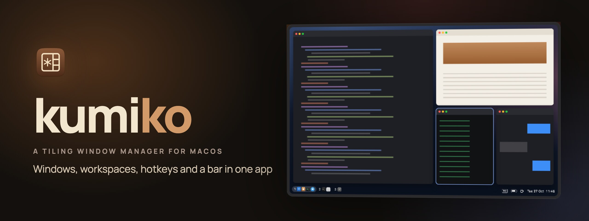

<p align="center">
	
	<a href="README.ru.md"></a>
</p>

<p align="center">
	<a href="https://kumiko.aimuzov.online"></a>
</p>

<p align="center">
	<a href="https://github.com/aimuzov/kumiko/releases/latest"></a>
	<a href="https://kumiko.aimuzov.online"></a>
	
	
	<a href="LICENSE"></a>
</p>

<h3 align="center">Windows, workspaces, hotkeys and a bar for macOS, in one app</h3>
<p align="center">Tiles windows into workspaces on each display, and a settings window edits the whole config</p>

A tiling window manager for macOS that comes as one app: windows and workspaces, hotkeys, a
status bar, a frame around the focused window, Vim modes in text fields and hiding of menu bar
items, sharing one process and one config file. Everything works without touching SIP but window
shadows and floating windows kept on top, which need a scripting addition in Dock.

## Install

With Homebrew:

```sh
brew install --cask aimuzov/tap/kumiko
```

The cask also puts the `kumiko` command on the `PATH` and takes the quarantine flag off the app, so
it opens straight away.

Or download `Kumiko-<version>.zip` from the [latest release](https://github.com/aimuzov/kumiko/releases/latest),
unzip it and move `Kumiko.app` to Applications. The app is not notarized yet, so the first time macOS
refuses to open it: try to open it once, then press Open Anyway under Privacy & Security in System
Settings.

## Build

```sh
scripts/bundle.sh          # dist/Kumiko.app, release build
scripts/test.sh            # unit tests
```

`KUMIKO_SIGN_IDENTITY="Developer ID Application: …" scripts/bundle.sh` signs for real. For local
builds run `scripts/dev-certificate.sh` once: it puts a self-signed certificate into the login
keychain, `bundle.sh` signs with it, and permissions survive rebuilds. Without either the bundle is
signed ad hoc, and macOS asks for permissions again after every rebuild.

## Run

Open `dist/Kumiko.app`. It lives in the menu bar; on first launch it asks for Accessibility (to
arrange windows) and Input Monitoring (for hotkeys and Vim). Its menu shows the workspace on each
display and the hotkey mode, can pause kumiko, and opens the settings window, which edits every
section of the config below and writes only the lines it changes.

The CLI is inside the bundle:

```sh
ln -s "$PWD/dist/Kumiko.app/Contents/MacOS/kumiko" ~/.local/bin/kumiko
kumiko status
```

| Command | Does |
| --- | --- |
| `kumiko ping` | checks that the app is running |
| `kumiko status` | modules, permissions, config path and the last config error |
| `kumiko reload` | rereads the config; also happens by itself when the file changes |
| `kumiko settings [page]` | opens the settings window, on `general`, `workspaces`, `rules`, `hotkeys`, `bar`, `borders`, `vim`… |
| `kumiko query windows\|focused\|workspaces\|displays` | prints the state as JSON |
| `kumiko window focus\|warp\|move\|resize\|ratio\|float\|zoom\|stack\|unstack\|close …` | acts on the focused window |
| `kumiko workspace focus\|balance\|rotate\|mirror\|layout …` | acts on the focused workspace |
| `kumiko menubar show\|hide\|toggle` | shows or hides the menu bar items left of the divider |
| `kumiko appearance [toggle\|dark\|light]` | switches the system between light and dark, keeping Automatic on; prints the current one with no argument |
| `kumiko sa status\|install\|load\|uninstall\|sudoers` | the scripting addition in Dock |
| `kumiko version` | version of the running app (`--version` for the CLI itself) |
| `kumiko quit` | quits the app, putting hidden windows back on screen |

`kumiko --help` lists every argument. Hotkeys run the same commands.

### Shadows and floating windows on top

Only Dock may change other apps' windows, so turning shadows off (`shadows = false`) and keeping
floating windows above the tiled ones (`float_on_top`) go through a scripting addition kumiko loads
into Dock. That needs System Integrity Protection partly off, the same way yabai's does: follow
[yabai's steps](https://github.com/koekeishiya/yabai/wiki/Disabling-System-Integrity-Protection),
then `sudo kumiko sa load`. Without it everything else works and windows keep their shadows.

Dock comes back without the scripting addition after a restart. `kumiko sa sudoers` prints a
sudoers line that lets kumiko load it again by itself; it is tied to the binary, so write it again
after a rebuild.

## Config

`~/.config/kumiko/kumiko.toml` (`$XDG_CONFIG_HOME` is respected). Every key is optional; no file at
all is a valid config. A broken file keeps the previous config in force and shows the error in the
settings window and in `kumiko status`.

```toml
[wm]
enabled = true
manage = true             # windows no rule speaks about are tiled
gap = 8
padding = 4               # or { top = 4, bottom = 40, left = 4, right = 4 }
hide_apps = true          # hide an app (like cmd-h) while none of its windows is on screen
shadows = true            # false needs the scripting addition
float_on_top = true       # floating windows stay above the tiled ones; scripting addition too
float_settings = true     # settings windows of every app float, whatever the rules say
float_fixed_size = true   # so do windows that cannot be resized
keep_on_screen = false    # a window dragged past the screen edge slides back
workspaces = true         # false: one workspace per display
rules = true              # false: `manage` alone decides

# The last rule that matches a window wins. `app` is the whole app name, `title` and `id` are
# found anywhere in the window's title and identifier; all three are regular expressions.
[[wm.rule]]
app = "Finder"
title = "Copy|Info"
manage = false

[[wm.rule]]
app = "Dia"
id = "preferencesWindow"    # a window with no title still has an id
manage = false

# Workspaces in file order: `workspace focus 1` is the first. Without any, "1"…"9" on main.
[[workspace]]
name = "Code"
display = "main"            # main, external, builtin, or part of a screen's name
apps = ["Ghostty", "Code"]  # their windows open here, laid out in this order
layout = "bsp"              # bsp, stack or float
size = { Code = 0.6 }       # how much of its split a window of the app takes

[[workspace]]
name = "Chat"
display = "external"
default = true              # windows of apps no workspace names open here
stack = ["Telegram"]        # kept in one stack

[hotkeys]
enabled = true
blacklist = ["Screen Sharing"]
on_mode_change = "echo $KUMIKO_MODE"

[hotkeys.bind]
"alt - 1" = "workspace focus 1"
"alt - h" = "window focus west || workspace focus prev"
"alt - r" = { mode = "resize" }
"cmd - h" = { block = true }               # take a system shortcut away
"cmd + ctrl - j" = { send = "down" }       # remap a key

[hotkeys.mode.resize]
"h" = "window resize left 40"
"escape" = { mode = "default" }

[bar]
enabled = true
scale = 1.0                 # the height grows with it
left = ["workspaces", "mode", "window"]
right = ["datetime", "caffeinate", "battery", "input"]
magnification = "dock"      # icons grow under the pointer: dock, on or off
take_from_menu_bar = true   # the macOS menu bar leaves battery, input and a digital clock to the bar

[[bar.shell]]
name = "load"
command = "sysctl -n vm.loadavg"
interval = 10

[borders]
enabled = true
width = 4
color = "accent"            # or "#8aadf4"; no key follows the accent colour too
blacklist = ["Steam"]

[menubar]
enabled = false
rehide = 0                  # seconds before shown items hide again, 0 for never

[vim]
enabled = false
blacklist = ["Ghostty", "Code"]
commands = ["set langmap=ФИСВУАПРШОЛДЬТЩЗЙКЫЕГМЦЧНЯ;ABCDEFGHIJKLMNOPQRSTUVWXYZ"]
```

`main` is the display System Settings calls main, the one with the menu bar, and `external` the
other one: a monitor first, the laptop's own screen when the menu bar sits on the monitor. A
display that is not attached falls back to main, so a laptop on its own still shows every
workspace.

Hotkeys are written the way skhd writes them, by key position on an ANSI keyboard, so they stay
put whatever input source is on. A binding is a kumiko command, with `||` to try the next one, or
a table of `run`, `shell`, `mode`, `send` and `block`. `[hotkeys.global]` works in every mode.

The bar can also show what a shell command prints (`[[bar.shell]]`), take its colours from
`[bar.colors]` and its font from `font` and `font_size`. A click on a workspace shows it, on an
app's icon focuses its window, on the time opens Calendar, on the battery shows its percentage and
on the input source switches it.

`[menubar]` hides status items of the macOS menu bar, the way Ice does. It adds a chevron and an
invisible divider; items left of the divider hide. Move them in the General page of the settings
window or cmd-drag them across the divider. A click on the chevron shows or hides them.

`[vim]` gives every text field Vim's modes, the way SketchyVim does, except in the apps it names.
`commands` run at start, svimrc style.

## License

MIT
