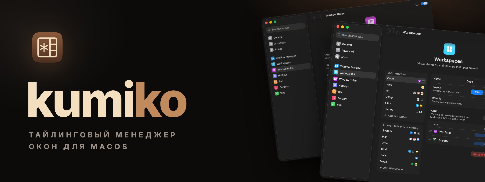

<p align="center">
	<a href="README.md"></a>
	
</p>

<p align="center">
	<a href="https://kumiko.aimuzov.online"></a>
</p>

<p align="center">
	<a href="https://github.com/aimuzov/kumiko/releases/latest"></a>
	<a href="https://kumiko.aimuzov.online"></a>
	
	
	<a href="LICENSE"></a>
</p>

<h3 align="center">Окна, рабочие столы, хоткеи и бар для macOS в одном приложении</h3>
<p align="center">Раскладывает окна по рабочим столам на каждом экране, а окно настроек правит весь конфиг</p>

Тайлинговый менеджер окон для macOS, собранный в одно приложение: окна и рабочие столы, хоткеи,
бар, рамка вокруг окна в фокусе, Vim-режимы в текстовых полях и скрытие значков строки меню. Всё
это один процесс и один конфиг. Без SIP работает всё, кроме снятия теней и плавающих окон поверх
раскладки: им нужен scripting addition в Dock.

## Установка

Через Homebrew:

```sh
brew install --cask aimuzov/tap/kumiko
```

Каск заодно кладёт команду `kumiko` в `PATH` и снимает с приложения флаг карантина, так что оно
открывается сразу.

Или скачай `Kumiko-<версия>.zip` из [последнего релиза](https://github.com/aimuzov/kumiko/releases/latest),
распакуй и перенеси `Kumiko.app` в Applications. Приложение пока не нотаризовано, поэтому в первый
раз macOS его не откроет: попробуй открыть его один раз, затем нажми Open Anyway в разделе Privacy &
Security системных настроек.

## Сборка

```sh
scripts/bundle.sh          # dist/Kumiko.app, релизная сборка
scripts/test.sh            # юнит-тесты
```

`KUMIKO_SIGN_IDENTITY="Developer ID Application: …" scripts/bundle.sh` подписывает по-настоящему.
Для локальных сборок один раз запусти `scripts/dev-certificate.sh`: он кладёт самоподписанный
сертификат в связку ключей, `bundle.sh` подписывает им, и права переживают пересборку. Без него
бандл подписан ad hoc, и macOS заново спрашивает права после каждой сборки.

Релизная сборка ещё и загружает в Sentry отладочные символы, чтобы в отчётах о сбоях был код, а не
адреса. Для этого нужны [`sentry-cli`](https://docs.sentry.io/cli/) (`brew install getsentry/tools/sentry-cli`)
и токен организации в `SENTRY_AUTH_TOKEN`. Сборка с `KUMIKO_SIGN_IDENTITY` без токена
останавливается: сбои из неё пришли бы нечитаемыми.

## Запуск

Открой `dist/Kumiko.app`. Он живёт в строке меню и при первом запуске просит Accessibility (чтобы
раскладывать окна) и Input Monitoring (для хоткеев и Vim). В его меню видно рабочий стол на каждом
экране, там же пауза и окно настроек. Окно настроек правит каждый раздел конфига
ниже и переписывает только те строки, которые меняет.

CLI лежит внутри бандла:

```sh
ln -s "$PWD/dist/Kumiko.app/Contents/MacOS/kumiko" ~/.local/bin/kumiko
kumiko status
```

| Команда | Что делает |
| --- | --- |
| `kumiko ping` | проверяет, что приложение запущено |
| `kumiko status` | модули, права, путь к конфигу и последняя ошибка в нём |
| `kumiko reload` | перечитывает конфиг; это происходит и само, когда файл меняется |
| `kumiko settings [page]` | открывает окно настроек на `general`, `workspaces`, `rules`, `hotkeys`, `bar`, `borders`, `vim`… |
| `kumiko query windows\|focused\|workspaces\|displays` | печатает состояние в JSON |
| `kumiko window focus\|warp\|move\|resize\|ratio\|float\|zoom\|stack\|unstack\|close …` | действие с окном в фокусе |
| `kumiko workspace focus\|balance\|rotate\|mirror\|layout …` | действие с рабочим столом в фокусе |
| `kumiko menubar show\|hide\|toggle` | показывает или прячет значки строки меню левее разделителя |
| `kumiko appearance [toggle\|dark\|light]` | переключает светлую и тёмную тему системы, не выключая автоматическую; без аргумента печатает текущую |
| `kumiko sa status\|install\|load\|uninstall\|sudoers` | scripting addition в Dock |
| `kumiko version` | версия запущенного приложения (`--version` у самого CLI) |
| `kumiko quit` | выход, спрятанные окна возвращаются на экран |

`kumiko --help` перечисляет все аргументы. Хоткеи запускают те же команды.

### Тени и плавающие окна поверх

Менять чужие окна может только Dock, поэтому снятие теней (`shadows = false`) и плавающие окна
поверх раскладки (`float_on_top`) идут через scripting addition, который kumiko загружает в Dock.
Для этого нужен частично отключённый System Integrity Protection, как у yabai: пройди
[шаги из вики yabai](https://github.com/koekeishiya/yabai/wiki/Disabling-System-Integrity-Protection),
потом `sudo kumiko sa load`. Без него всё остальное работает, а у окон остаются тени.

После перезапуска Dock приходит без scripting addition. `kumiko sa sudoers` печатает строку для
sudoers, с которой kumiko загружает его сам; она привязана к бинарю, так что после пересборки её
нужно записать заново.

## Конфиг

`~/.config/kumiko/kumiko.toml` (`$XDG_CONFIG_HOME` учитывается). Каждый ключ необязателен, и даже
отсутствие файла -- рабочий конфиг. Сломанный файл оставляет в силе предыдущий конфиг, а ошибку
показывает в окне настроек и в `kumiko status`.

```toml
[wm]
enabled = true
manage = true             # окна, о которых не говорит ни одно правило, раскладываются
gap = 8
padding = 4               # или { top = 4, bottom = 40, left = 4, right = 4 }
hide_apps = true          # прятать приложение (как cmd-h), пока ни одно его окно не на экране
shadows = true            # для false нужен scripting addition
float_on_top = true       # плавающие окна поверх раскладки; тоже scripting addition
float_settings = true     # окна настроек любых приложений плавают, что бы ни говорили правила
float_fixed_size = true   # как и окна, размер которых не меняется
keep_on_screen = false    # окно, утащенное за край экрана, возвращается обратно
workspaces = true         # false: один рабочий стол на экран
rules = true              # false: решает только `manage`

# Выигрывает последнее правило, подошедшее окну. `app` -- имя приложения целиком, `title` и `id`
# ищутся где угодно в заголовке и идентификаторе окна; все три -- регулярные выражения.
[[wm.rule]]
app = "Finder"
title = "Copy|Info"
manage = false

[[wm.rule]]
app = "Dia"
id = "preferencesWindow"    # у окна без заголовка всё равно есть id
manage = false

# Рабочие столы по порядку в файле: `workspace focus 1` -- первый. Без них "1"…"9" на main.
[[workspace]]
name = "Code"
display = "main"            # main, external, builtin или часть имени экрана
apps = ["Ghostty", "Code"]  # их окна открываются здесь и встают в этом порядке
layout = "bsp"              # bsp, stack или float
size = { Code = 0.6 }       # сколько своего разреза занимает окно приложения

[[workspace]]
name = "Chat"
display = "external"
default = true              # сюда открываются окна приложений, которых не назвал ни один стол
stack = ["Telegram"]        # держатся в одной стопке

[hotkeys]
enabled = true
blacklist = ["Screen Sharing"]
on_mode_change = "echo $KUMIKO_MODE"

[hotkeys.bind]
"alt - 1" = "workspace focus 1"
"alt - h" = "window focus west || workspace focus prev"
"alt - r" = { mode = "resize" }
"cmd - h" = { block = true }               # отобрать системный шорткат
"cmd + ctrl - j" = { send = "down" }       # переназначить клавишу

[hotkeys.mode.resize]
"h" = "window resize left 40"
"escape" = { mode = "default" }

[bar]
enabled = true
scale = 1.0                 # высота растёт вместе с ним
left = ["workspaces", "mode", "window"]
right = ["datetime", "caffeinate", "battery", "input"]
magnification = "dock"      # иконки растут под курсором: dock, on или off
take_from_menu_bar = true   # строка меню macOS отдаёт бару батарею, раскладку и цифровые часы

[[bar.shell]]
name = "load"
command = "sysctl -n vm.loadavg"
interval = 10

[borders]
enabled = true
width = 4
color = "accent"            # или "#8aadf4"; без ключа тоже цвет акцента
blacklist = ["Steam"]

[menubar]
enabled = false
rehide = 0                  # через сколько секунд показанные значки снова прячутся, 0 -- никогда

[vim]
enabled = false
blacklist = ["Ghostty", "Code"]
commands = ["set langmap=ФИСВУАПРШОЛДЬТЩЗЙКЫЕГМЦЧНЯ;ABCDEFGHIJKLMNOPQRSTUVWXYZ"]

[telemetry]
crash_reports = true
```

Экран `main` -- тот, который System Settings называет главным, со строкой меню, а `external` -- второй:
сначала монитор, а если строка меню на мониторе, то встроенный экран ноутбука. Неподключённый экран
заменяется на main, так что на одном ноутбуке видны все рабочие столы.

Хоткеи записываются как в skhd, по положению клавиши на ANSI-клавиатуре, поэтому не съезжают при
смене раскладки. Привязка -- это команда kumiko, с `||`, чтобы попробовать следующую, или таблица из
`run`, `shell`, `mode`, `send` и `block`. `[hotkeys.global]` работает в любом режиме.

Бар умеет показывать вывод shell-команды (`[[bar.shell]]`), брать цвета из `[bar.colors]`, а шрифт
из `font` и `font_size`. Клик по рабочему столу показывает его, по иконке приложения -- фокусирует
его окно, по времени -- открывает Calendar, по батарее -- показывает проценты, по раскладке --
переключает её.

`[menubar]` прячет значки строки меню macOS, как Ice. Он добавляет шеврон и невидимый разделитель;
значки левее разделителя прячутся. Переносить их можно на странице General окна настроек или
перетаскивая с cmd через разделитель. Клик по шеврону показывает или прячет их.

`[vim]` даёт любому текстовому полю режимы Vim, как SketchyVim, кроме названных приложений.
`commands` выполняются при старте, как в svimrc.

`[telemetry]` -- это отчёты о сбоях. Когда kumiko падает или ловит необработанное исключение, он
отправляет отчёт в [Sentry](https://sentry.io): стек, версию kumiko и версию macOS. Названия окон и
приложений и имя мака туда не попадают. `crash_reports = false` выключает отправку сразу, без
перезапуска.

## Лицензия

MIT
